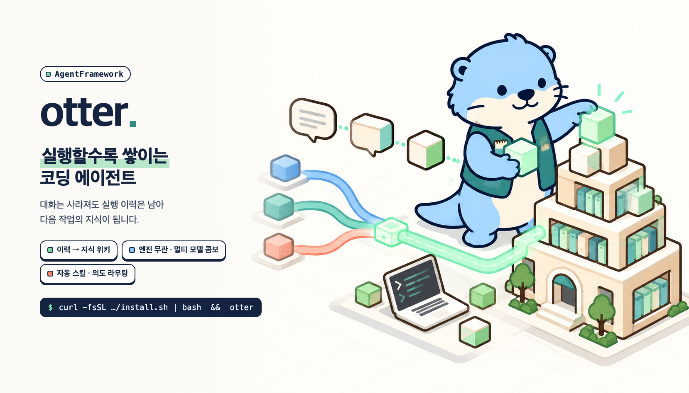

# AgentFramework (`otter`)



**실행할수록 쌓이는 코딩 에이전트.**

- 실행 이력을 버리지 않고 로컬 지식으로 쌓아 다음 작업에 다시 씀
- 엔진·모델과 무관하게 같은 자산으로 쌓임, 역할마다 모델을 섞어 씀
- 대화 중에 직접 고치고 실행함. 모든 실행은 사람이 승인함(한 동작씩 또는 계획 단위)

```sh
# macOS / Linux
curl -fsSL https://raw.githubusercontent.com/KimJiSeong1994/AgentFramework/master/install.sh | bash
otter
```

```powershell
# Windows (PowerShell, WSL2 사용)
irm https://raw.githubusercontent.com/KimJiSeong1994/AgentFramework/master/install.ps1 | iex
otter
```

## 1. 실행 이력이 자산이 된다

**대화는 사라져도 이력은 남아 다음 작업의 컨텍스트가 된다.**

`대화·실행 → 실행 로그 → 지식 위키 → 다음 작업의 컨텍스트`

- **기록**: 도구 호출 결과를 append-only SQLite(`tool-outcomes.sqlite`)에 저장. 메타데이터만 남기고 인자·출력 본문은 저장 안 함
- **축적**: `otter-wiki capture`로 불변 원본 스냅샷 + 리포트 생성, `knowledge/wiki`에 출처 연결된 개념·엔티티 페이지로 정리
- **재사용**: 대화 중 모델이 `memory` 도구로 위키를 찾아 컨텍스트로 사용(`/memory`로 연결 엔진 설정)
- **복원**: 세션은 재시작해도 보관. 시작은 항상 새 대화, 필요할 때 `--resume`·`--continue`·`/sessions`·`/resume <sid>`

```sh
bun scripts/otter-wiki.ts capture   # 이력 → 위키
bun scripts/otter-wiki.ts status    # 출처·정리 상태
bun scripts/otter-wiki.ts lint      # 링크·해시 무결성
```

## 2. 엔진을 가리지 않는다 · 멀티 모델 콤보

**어떤 엔진을 써도 기록은 하나, 역할마다 잘하는 모델을 쓴다.**

- **엔진 무관**: Ollama(로컬)·Codex·Claude CLI 모두 같은 이력 형식. 대화 중 `/model`로 전환
- **콤보**: planner / architect / critic / worker / reviewer 역할별로 엔진·모델 지정. 미지정 역할은 메인 모델
- **프리셋**: 추천 조합 제공(예: *Astra + Fable*: Astra 계획 · Luna 실행 · Fable 리뷰). 고르면 저장하고 **지금 세션에 바로 적용**(대화 이어짐)
- **인증**: 각 CLI 공식 로그인 그대로 사용. otter는 인증 정보를 읽거나 저장하지 않음

```text
/model combo                                   # 메뉴: 추천 프리셋(고르면 바로 적용) 또는 역할 → 엔진 → 모델
/model combo preset astra-fable                # 프리셋 저장 + 바로 적용
/model combo planner claude opus               # 역할 직접 지정(저장만)
/model combo apply                             # 직접 지정한 콤보를 적용(대화 이어짐)
```

## 3. 자동 스킬 · 의도 라우팅

**알아서 돕되, 멋대로 하지 않는다.**

- **자동 스킬**: 맥락에 맞는 스킬을 모델이 직접 불러 쓰고 `Skills used: <name>` 표시. 동의 창 없이 쓸 수 있는 스킬만 후보
- **의도 라우팅**: 모호하거나 설계 수준 요청은 전송 전 [채팅 계속 | deep-interview | ralplan | 취소] 제안. 질문은 답변만
- **워크플로**: `ralplan`·`deep-interview`·`ultragoal`·`autoresearch`를 `/skill:<name>`으로 시작. 자동 시작 없음
- **끄기**: 메시지 하나는 `force:` 접두사, 세션은 `/skills auto off`, 영구는 `skill_auto.mode: "off"` / `chat.intent: "off"`
- Codex/Claude 관례 스킬은 `skill_auto.include`(`~/.config/otter/otter.jsonc`)에 등록해야 후보가 됨
- **제공 스킬 목록**: [`skill_index.md`](skill_index.md)(내장 워크플로 4종 + 프로젝트 스킬 2종, 추가 방법)

## 직접 실행 · 안전장치

**모든 실행은 사람이 승인한다 — 한 동작씩 또는 계획 단위.**

- **대화 중 직접 실행**(기본 `chat.execute: "ask"`): otter가 파일 수정(`edit`/`write`)과 명령 실행(`bash`)을 직접 요청 → 동작마다 [한 번 허용 | 항상 허용 | 거부]
  - 수정은 diff, 명령은 명령줄과 시간 제한을 보여 주고 결과를 모델에게 돌려줌. 거부도 모델에게 전달돼 다른 방법을 찾음
  - 대화형 명령(`vim`, 비밀번호 입력 등)은 승인 후 터미널을 넘겨줌(출력은 저장 안 됨)
  - `sudo`, 강제 푸시, 루트/홈 삭제, 디스크 포맷 등은 승인해도 거부. 직접 하려면 `!명령어`
  - "항상 허용"은 명령 앞부분(`bun test` 등) 규칙으로 사용자 설정에만 저장. 프로젝트 설정의 허용은 무시. `/permissions`로 보기·지우기
  - 모드: `"ask"`(기본) · `"auto-edit"`(파일 수정은 묻지 않음, 명령은 물음) · `"plan"`(읽기 전용) — `~/.config/otter/otter.jsonc`의 `chat.execute`
- **계획 단위 실행**: `/plan` → 사람이 `/approve` → 작업자가 실행. 자동 승인 없음, 원장(ledger)에 기록. 큰 작업용
- **체크아웃 보호**: 계획은 작업 트리 `wf-<id>`에서 실행 → diff 요약 후 [적용 | 유지 | 버리기]. 끄기 `chat.worktree: "off"`
- 작업 트리는 체크아웃 보호용이며 샌드박스(프로세스·파일시스템 격리)는 아님

## 설치

- macOS/Linux, `git` 필요. `bun`은 없으면 자동 설치
- 엔진(`ollama`/`codex`/`claude`) 하나 이상이 PATH에 있어야 함
- 로그인 `otter login codex|claude`, 상태 `otter auth`(대화 중 `/login`·`/auth`·`/logout`)
- **업데이트**: `otter update`(확인만 `otter update --check`). 새 버전이 나오면 `otter` 시작 시 `Update available … Run: otter update` 알림(하루 한 번 백그라운드 확인, 설치는 하지 않음). 끄기: `~/.config/otter/otter.jsonc`에 `"update": { "check": false }` 또는 `OTTER_NO_UPDATE_CHECK=1`
- 제거는 `~/.local/share/otter/AgentFramework/install.sh --uninstall`

**Windows**: otter는 POSIX 소유권·권한 검사에 기대므로 WSL2(기본 Ubuntu) 안에서 실행됨
- 준비: 관리자 PowerShell에서 `wsl --install` → 재부팅 → Ubuntu를 한 번 열어 사용자 생성
- 설치: `irm …/install.ps1 | iex`. WSL 안에서 `install.sh`를 돌리고 `%LOCALAPPDATA%\otter\bin\otter.cmd`를 만들어 사용자 PATH에 추가 → PowerShell·cmd·Windows Terminal에서 `otter`
- 엔진 CLI(`codex`/`claude`/`ollama`)와 로그인은 **WSL 안에** 있어야 함. Windows에 설치한 `codex.exe`/`claude.exe`의 로그인은 WSL에서 쓸 수 없어 무시함
- `otter`는 WSL 로그인 셸(`~/.profile`·`~/.bashrc`)을 읽어 nvm·npm·설치 프로그램으로 넣은 CLI를 찾음. 확인: `otter auth`
- 로그인: `otter login codex`는 Windows 기본 브라우저를 열고, 안 열리면 출력된 URL을 Windows에서 열면 됨. localhost에 못 돌아오면 `otter login codex device`(코드 입력 방식)
- 프로젝트는 WSL 파일시스템(`\\wsl$\Ubuntu\home\<you>\...`)에 두는 것을 권장. `C:\` 드라이브(`/mnt/c`)는 파일 접근이 느림
- 배포판 지정 `$env:OTTER_DISTRO='Ubuntu-24.04'`, 제거 `$env:OTTER_UNINSTALL='1'; irm …/install.ps1 | iex`

## 사용

```sh
otter                                      # 새 대화(기본 모델 또는 /model 선택)
otter --engine codex --model gpt-5.6-sol   # 엔진·모델 지정
otter --resume                             # 지난 세션 선택
otter --continue                           # 최근 세션 이어가기
otter status --worktree .                  # 엔진 없이 워크플로·원장 상태 확인
```

대화 중: `/model` · `/plan` · `/approve` · `/sessions` · `/resume` · `/memory` · `/skills` · `/login` · `/auth` · `/help`

## 문서

- 사용법·설정: [`framework/README.md`](framework/README.md)
- 스킬 목록: [`skill_index.md`](skill_index.md)
- 위키 스키마: [`knowledge/AGENTS.md`](knowledge/AGENTS.md)
- 설계: [`docs/agent-framework-review-2026-09-22.md`](docs/agent-framework-review-2026-09-22.md)

## 라이선스

[MIT](LICENSE)
